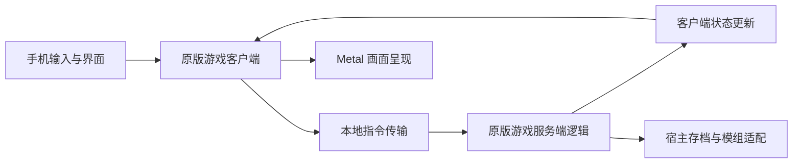
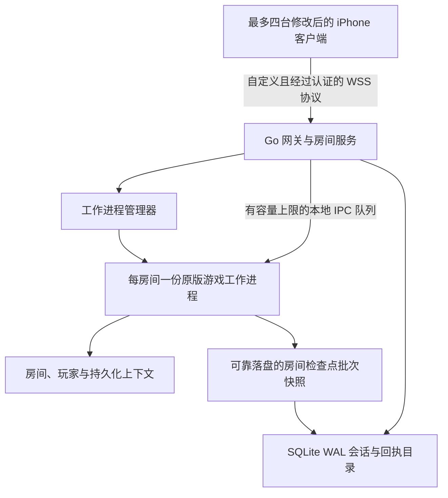

# D2R 四人私服设计

**状态：** 已接受的有条件方案；仓库边界已调整为独立服务端仓库，G0–G5 均未通过

**模块：** d2r-server

**日期：** 2026-10-20

**源码基线：** [jhaizhou-ops/d2r-mobile](https://github.com/jhaizhou-ops/d2r-mobile) 的 v1.0.18，`120fe55c02a5633476998a44f8c3c3c809fa48b0`；来源固定在 [`upstream.lock.json`](../../upstream.lock.json)

## 文档沿革与实施状态

本方案在 2026-10-20 完成源码及聚焦 REA 调研，并纳入 Copilot 与独立审查意见，覆盖入场幂等、取消隔离、持久化及网络验收条件。用户接受方案后，确定新建公开的 [codetrek/d2r-server](https://github.com/codetrek/d2r-server) 仓库，以便手机 fork 持续跟进上游。本文将该仓库边界纳入 ADR 011；它不改变原有游戏行为与持久化验收要求。

当前仓库已经实现 Go 静态布局检查工具 `d2r-inspect`，并建立控制进程的健康、就绪与能力查询入口。检查工具可校验自有 Guest 及配套 fixups，逐字节重建分析映像并输出来源清单；它不执行引擎。控制进程在游戏工作进程通过资格验证前保持未就绪。Linux 游戏工作进程、房间、传输桥接、四人联机、角色持久化及恢复均尚未实现，G0–G5 均未通过。源码工具构建成功或重建映像哈希一致，只是调研基础设施的进展。

## 目录

1. [问题与目标](#1-问题与目标)
2. [当前架构](#2-当前架构)
3. [需求与边界](#3-需求与边界)
4. [方案比较](#4-方案比较)
5. [推荐方案](#5-推荐方案)
6. [迁移与验证门槛](#6-迁移与验证门槛)
7. [测试策略](#7-测试策略)
8. [可观测性与遥测](#75-可观测性与遥测)
9. [风险评估](#8-风险评估)
10. [架构决策记录](#9-架构决策记录)

## 1. 问题与目标

当前安装的游戏在手机本地同时运行客户端和权威游戏逻辑，即由本地游戏服务统一计算并裁决游戏结果。目前没有已验证可供四台手机使用的私服。目标是在 Linux/Docker 上运行这套权威逻辑，让玩家共享战斗、怪物、掉落和任务，同时继续使用手机拥有的本地角色。

开源仓库提供宿主程序、平台适配和游戏修改；原版游戏逻辑仍在所提供的游戏二进制中。现有指令回放是在已经初始化的本地会话内使用的诊断功能：它只记住一个游戏和客户端身份，并直接向分发函数注入指令，还不具备多人联机能力（`dm/host/diag.c:1151–1177,1378–1394`）。

配套的[协议与运行时证据报告](2026-10-20-protocol-research.md)记录了源码永久链接、真实 REA 证据、外部先例和未解决的问题。本方案区分**已经验证的内部接入点**、**拟议接口**和**尚未通过的可行性验证门槛**。文档没有给出一套已经还原完成的官方网络协议。

## 2. 当前架构



本地游戏逻辑每秒推进 25 个逻辑帧（`hle_hid.c:161`；调度器解释见 `diag.c:1433–1445`）。渲染帧率和网络发送频率需要分别考虑。

REA/Ghidra 已经独立核对发行产物中的两段函数体：

- 发送入口 `main+0x2ceab0` 通过位于 `main+0x2d9f438` 的内嵌对象及其虚方法 `+0x30` 提交一段字节范围。`<0x200` 的长度检查只属于这个入口。
- 接收入口 `main+0x632510` 读取前置连接号，依次找到连接、游戏和玩家，再调用游戏指令分发函数 `0x6e5b40`。它将数据指针前移四字节，同时原样转发长度参数。调用方对长度的约定仍未查明。

源码还实现了服务端向客户端发送消息的调用：使用位于 `main+0x2d7f3d8` 的内嵌对象、虚方法 `+0x28`、接收方连接号和起止字节范围（`dm_elysium.c:325–339`）。具体传输实现、缓冲区生命周期、完整的服务端到客户端（S2C）消息边界、入场流程和远程客户端启动仍需验证。诊断 JSON、状态哈希和进程内指针不能直接充当网络数据包。

要在 Linux 上复用原程序，需要新的宿主适配配置。目前的依赖包括 Darwin 线程局部存储（`loader.c:42–49`）、补丁在栈指针 SP 以下使用的临时空间（`dm/tools/patch_nso.py:391–420`）、Mach 内存与信号处理、Apple 框架，以及 APFS 存档事务（`hle_fs.c:22,36–41,429–475`）。不显示窗口并不代表引擎可以完全脱离图形系统运行；渲染和画面呈现也可能驱动确定性时钟。

受影响的组件包括原程序加载与改写、平台 HLE（高层模拟）、调度器、传输端口、账号与文件系统适配、手机入场和退出流程、云同步及模组。目前账号、存档、分页仓库、vault 和 rift 等单例状态需要明确归属。每个房间单独运行一个进程可以隔离房间，但不能自动隔离同房间内的四名玩家。

## 3. 需求与边界

| 编号 | 必须满足的行为 |
|---|---|
| R1 | 私有房间最多接纳四名可独立识别的玩家。第五名玩家入场失败时，不干扰现有房间。 |
| R2 | 修改后的 iPhone 客户端负责渲染并提交操作；一份服务端游戏逻辑统一裁决共享结果。手机不再运行与其竞争的权威游戏世界。 |
| R3 | 每次入场都从手机选中的本地角色及相关持久化数据生成一份新的不可变快照并导入。无需由服务器永久保管角色库。 |
| R4 | 已提交的角色结果安全返回原手机，包括相关模组辅助存档文件和共享仓库变化。结果返回中断后仍可恢复。 |
| R5 | Linux/Docker 部署使用有文档、经过实测的房间工作进程平台。服务器 CPU 架构尚未决定。 |
| R6 | 玩家入场前，原程序构建、游戏数据表、模组规则和协议配置必须与受支持版本一致。 |
| R7 | 掉线、重连、服务器崩溃、手机挂起及并发云操作，都有明确的数据归属和恢复行为。 |
| R8 | 一个房间的崩溃或资源耗尽，不得破坏另一个房间或手机最后一次已提交的本地存档。 |

可选功能包括邀请链接和简单的房间管理查看功能。本任务不涵盖未修改的官方客户端、Battle.net 模拟、公共匹配、跨版本兼容层，以及对独立编辑的离线存档分支进行全局防复制。只要手机仍保有离线使用角色的权利，就无法保证最后一项。

## 4. 方案比较

| 策略 | 游戏规则还原程度 | Linux 与 CPU 的影响 | 证据与成本 |
|---|---|---|---|
| A. 复用原版游戏逻辑，新增传输层与 Linux 宿主 | 成功分离后可保留原版规则 | 原程序是 ARM64，需要原生 ARM64 宿主，或经过实测的指令翻译 | 已有较明确的内部接入点；无界面生命周期、入场和多人模组仍未验证。作为有条件的推荐方向。 |
| B. 独立编写服务端游戏逻辑 | 需要重现所有规则、任务、物品和模组 | 原生实现可分别编译到 x86_64 和 ARM64 | 可解除对原版运行时的依赖，但行为重建工作量大得多。若 A 的关键验证失败，应作为独立项目重新评估。 |
| C. 适配已有 D2R 或经典暗黑服务端生态 | 取决于引擎和版本 | 现代 D2RLoader 的先例面向 Windows x64；经典 D2GS 面向旧版《暗黑破坏神 II》 | 可作为调研参考，尚无已验证的 Linux/Switch ARM 互通或可直接替换的实现。 |

[D2RLoader](https://d2rloader.net/tcp-ip.html)记录了使用本地离线角色进行私有联机的方式。其 SDK 提供专用宿主的准备接口，但这只能作为先例，尚不能证明其核心可以在本项目复用。经典 D2GS 和未完成的开源引擎，也不能证明与本项目原程序兼容；证据和许可证比较见配套报告。

存储候选包括 SQLite WAL 加可靠落盘的文件系统快照、PostgreSQL 加对象存储，以及纯内存房间目录。单机私有部署选择 SQLite 与文件系统：它能提供持久化会话回执，无需引入分布式归属管理。纯内存方案无法满足 R4/R7，分布式存储在当前需求下没有足够依据。

## 5. 推荐方案

### 5.1 组件与权威归属



原程序宿主和与 ABI 相关的桥接层使用 C/汇编；网关、房间服务和进程管理器使用 Go。工作进程接口必须基于已验证的原程序状态归属及生命周期约定。即使工作进程最终需要 ARM64，控制服务仍可运行在 x86_64 上。Docker 负责封装已经可运行的环境，本身不提供指令翻译。

手机的联机入口仅初始化远程游戏所需的原版客户端显示和状态复制部分。联机时停用本地权威游戏逻辑、本地服务端自动存档及权威模组修改，把相应操作送到房间工作进程。G2 要通过故意构造相互冲突的本地与服务端状态，证明这层分离成立。

工作进程中的原程序线程独占所有引擎调用，并负责每 40 ms 的逻辑帧调度。网络线程只能将经过验证的字节范围复制到有容量上限的队列。套接字回调不能直接调用原程序指令分发。启动和关闭流程明确管理调度、取消及平台资源，不依赖画面呈现。

### 5.1.1 仓库边界与来源固定

| 仓库 | 代码归属 |
|---|---|
| [`codetrek/d2r-server`](https://github.com/codetrek/d2r-server) | Go 控制服务、网关与房间管理、进程管理、Linux 宿主及平台后端、服务端工具、检查点与恢复、Docker、服务端测试和设计文档。 |
| [`codetrek/d2r-mobile`](https://github.com/codetrek/d2r-mobile) | 手机联机入口、客户端消息桥接、本地账号租约与结果应用，以及两端确实需要的共享接口改造；继续维护上游更新。 |
| [`jhaizhou-ops/d2r-mobile`](https://github.com/jhaizhou-ops/d2r-mobile) | 当前研究基线的原始上游来源。引用固定到完整提交，不跟随可变分支。 |

[`upstream.lock.json`](../../upstream.lock.json) 记录原始上游、精确提交和已分析产物身份，是静态来源记录。当前没有引入共享 SDK、子模块或整套宿主副本。后续先确定 Linux 与 Apple 共用的实际代码边界，再将这部分提取为单一来源、具有版本契约的共享组件；两仓库分别固定经过验证的组件修订号。不能通过长期复制整个 `dm/host` 目录维护两个实现。

服务器专用平台代码归本仓库。两端接口变化分别提交到各自仓库，并记录彼此支持的提交和兼容性摘要；只有配套验证通过后才更新来源锁定。原版 Guest、资源包、真实存档、反编译全文和私有实验输出不进入公开仓库或公开镜像。依赖接入及私人调研材料的约定见[开发说明](../development.md)。

### 5.2 上下文与模组状态归属

- `RoomContext`：游戏句柄、房间检查点批次、受支持构建指纹、共享玩法规则、随机数状态和逻辑帧归属。
- `PlayerContext`：服务器分配的玩家身份、原程序连接与单位绑定、入场状态、连接代次，以及进度和确认状态。
- `AccountPersistenceContext`：服务器生成的导入命名空间、选定角色、账号与共享仓库文件、辅助存档文件和快照修订号。文件名和角色名不能作为身份标识。

按这些归属重构账号、文件系统路由及模组单例。分页仓库、pouch 和 vault 请求必须找到发起操作的玩家；rift 状态必须区分房间生成状态与各玩家进度；掉落和技能策略作为房间兼容性规则统一处理。G3 前需要审计宿主、HLE、模组中可变的全局状态，以及这些钩子触及的原程序全局状态。

状态归属清单记录符号或地址、读写位置、初始化与重置方式、拟定作用域、上下文传递、存档归属和对应测试编号。每个宿主状态都必须归类为手机专用、进程级不可变数据、房间、玩家或账号，不得留下未分类的可变宿主状态。使用不同玩家绑定执行原程序相关操作，观察跨玩家修改；仅分析源码不足以代表对二进制的穷尽覆盖。全局变量只有在语义确实属于整个进程或房间时才保留。

联机切换边界如下：

| 子系统 | 手机联机模式 | 房间工作进程 | 必须提供的集成验证记录 |
|---|---|---|---|
| 输入与呈现 | 输入、界面、渲染和音频；经桥接层发出操作 | 不依赖控制器和显示设备 | 远程操作影响服务端状态，手机显示返回结果 |
| 世界与时钟 | 仅做状态复制和插值，不推进本地权威逻辑帧 | 唯一的游戏世界逻辑帧和玩法修改来源 | 故意制造分歧的手机世界不能影响权威状态 |
| 传输 | 替换本地客户端到服务端（C2S）提交入口，将 S2C 消息送入已验证的客户端接收入口 | 绑定各玩家的系统和玩法消息入口，以及 S2C 接收方 | 双向完整消息与生命周期跟踪，包含入场流程 |
| 存档与云同步 | 占用租约与日志、不可变上传、结果暂存与应用 | 各账号工作目录及房间检查点批次 | 联机自动存档不能直接写手机本地角色；等待中的云应用保持暂存 |
| 模组 | 仅呈现状态与操作请求 | 按明确归属执行全部权威模组修改 | 状态归属清单和四名独立玩家的测试场景 |

联机模式不依赖把返回占位结果的 `hle_net.c` 改成官方服务客户端。新增的本项目桥接端口承载已验证的原程序消息。离线与联机入口在创建游戏前选定权威归属；切换模式前必须完成或取消当前会话，不能在仍在运行的世界中途切换权威来源。

### 5.3 自定义传输层

优先使用带认证的 WSS，提供有序传输并适应移动网络，最终选择取决于延迟和积压测量。控制消息涵盖认证、兼容性、房间入场、本地存档上传、重连和结果获取。二进制帧承载完整的原程序消息单元，显式标注方向、会话、连接代次和序列号；在约定查明前，把原程序字节视为不透明载荷。

以下是本项目拟议的接口，并非已经还原的原程序字段：

```text
BeginAdmission(admission_id, room_id, compatibility_digest, import_manifest_digest)
QueryAdmission(admission_id) -> 权威入场状态，以及已产生的终态回执
CancelAdmission(admission_id) -> 已隔离的终态结果，或正在关闭的已有会话
BindPeer(session_id, connection_generation) -> 由工作进程管理的连接绑定
SubmitGuestMessage(session_id, generation, sequence, direction, bytes)
FetchResult(session_id, export_receipt_id) -> 不可变清单与内容
```

客户端提供的原程序连接号不能直接获得权威身份。网关根据已认证会话派生玩家绑定。在已验证的缓冲区生命周期结束前复制待发送字节范围，并仅向解析出的目标接收方发送每条 S2C 消息。保留引擎消息边界；发送方、收包泵和接收方的长度约定共同查明前，不擅自添加或移除观察到的四字节字段。

经过验证的协议配置需要声明消息和上传限制、速率限制、各玩家及房间的队列上限，以及慢连接处理策略。数值来自实际抓取和四人压力测量，包含加载与背包操作的突发流量。缺少该配置时禁止正式运行。超过预算的连接通过既定会话清理流程退出，不能静默丢弃可靠玩法消息。确定采用 WSS 前，先测量丢包时的队头阻塞延迟。

### 5.4 验收目标与传输公平性

以下是**拟定的通过或失败条件**，并非引擎已达到的实测能力。每项结果都要记录硬件、CPU 配额、原程序及配置哈希和测试场景。G0/G1 可能证明这些目标不可行；此时必须明确修改决策，不能悄悄放宽失败指标。

| 测量项 | 必须满足的验收目标 |
|---|---|
| 四人稳定运行时的逻辑帧工作耗时 | 平均值 ≤32 ms、p99 ≤40 ms、p99.9 ≤80 ms；除单独测量的房间加载外，不得有原因未分类且超过 200 ms 的停顿 |
| 逻辑帧各阶段 | 分别测量入口处理、游戏计算、出口处理和存档序列化；入口与出口合计 p99 ≤5 ms，其余时间留给引擎和余量 |
| 检查点对引擎的暂停 | p99 ≤40 ms、最大值 ≤200 ms；在安全边界复制一致快照，文件系统及目录数据库 I/O 在原程序逻辑帧线程之外执行 |
| 检查点可靠落盘并发布 | 验收环境下 ≤2,000 ms；失败或延迟必须显式暴露，不能转换为成功回执 |
| 各玩家的玩法消息积压 | 达到 250 ms 时告警；积压时间超过 2,000 ms 或达到队列容量上限后，经正常持久化流程关闭，并报告最近已提交批次 |
| 队列容量 | 每名玩家最多积压 8 MiB 玩法数据，四人房间合计最多 32 MiB；若有效加载突发流量超过上限，该配置验收失败，必须明确修订设计 |
| 验收时长 | 每种网络劣化场景至少 10 分钟；四人混合玩法连续稳定性测试至少 60 分钟 |

少量会话控制消息、玩法消息和批量存档传输分别使用独立的 WSS 连接及配额，防止存档分块占据玩法流。这仍无法消除玩法流内部的 TCP 队头阻塞。网关在玩家之间公平调度，独立限制各玩家，并在每条已验证消息流内保留引擎顺序。如果引擎要求跨流有序，必须显式保留这种顺序，不能凭推测拆流。限制上传对共享上行带宽的占用；玩法出现积压时暂停批量传输。

在可复现的基准网络和 100 ms 往返时延、20 ms 抖动、1% 丢包条件下验收，另外记录突发丢包及重连场景。将传输与排队新增延迟和注入的网络延迟分开测量。未满足约定条件时，G5 保持失败。在重新考虑消息语义前，使用同一组已记录消息评估支持独立、有序、可靠消息流的自定义传输方案；选择该替代方案必须新增明确的 ADR，并重做 G0/G5 验证记录。

### 5.5 手机本地角色导入与可恢复的结果返回

手机生成快照前，先取得账号存档的独占租约，即持续占用锁。范围覆盖选定角色、共享仓库及相关辅助存档文件；占用期间暂停该账号的本地游戏写入、新的账号级联机入场，以及云合并与应用。云下载可以暂存在别处，但不能替换正被占用的数据。即使角色同名，服务器上的不同账号也要保持隔离。

入场状态机如下，括号内保留拟议状态标识：

```text
本地就绪（LocalReady）→ 占用并生成快照（LocalLeaseAndSnapshot）
  → 上传验证完成（UploadValidated）→ 工作进程已导入（WorkerImported）
  → 活跃（Active）→ 关闭中（Closing）→ 结果已可靠落盘（DurableExport）
  → 手机已应用（PhoneApplied）→ 占用已释放（Released）
活跃前阶段（Pre-Active）→ 拒绝或取消（RejectOrCancel）
  → 已隔离的中止回执（FencedAbortReceipt）→ 释放原本地副本（OriginalLocalReleased）
```

上传前，手机写入可靠落盘的日志，记录唯一的 `admission_id`、本地修订号、会话随机标识和不可变快照摘要。`BeginAdmission` 以该编号及摘要保证幂等，在工作进程附着前可靠记录预留状态；同一编号携带冲突参数重试时明确失败。将角色、账号及辅助文件的明确清单导入新命名空间，在交给引擎解析前验证完整清单和兼容性配置。每次新入场生成新快照；重连则恢复已有会话，不再次导入可能更旧的手机副本。

入场失败必须有终态。兼容性、清单或容量检查拒绝入场后，生成绑定入场编号及导入摘要的持久化拒绝或中止回执。`CancelAdmission` 原子地使本次入场失效，禁止后续工作进程附着或接收指令。如果工作进程可能已经持有该入场，会话进入 `Closing`；进程管理器必须撤销绑定，并确认引擎完成清理或工作进程已终止，再签发终态回执。归属代次被撤销后，旧工作进程不能发布检查点。

只有在**已证实没有副作用、尚未附着到引擎或游戏世界的边界**，并且已经阻止所有后续附着时，中止回执才允许复用未改动的原始本地快照。只要可能发生过引擎附着，取消就必须走正常的房间检查点批次导出流程：被动经验、伤害、自动操作或其他玩家，都可能修改没有发出任何指令的空闲角色。不能根据“指令数为零”认定导入后没有发生变化。

入场响应丢失或进程重启后，手机查询或重试同一个入场编号，不创建第二次导入。服务器返回同一份已提交状态或回执；即使尚未见过某编号，也要记录该编号的取消墓碑，防止延迟到达的 `BeginAdmission` 之后重新附着。手机验证终态拒绝或中止回执后，才释放原占用租约。状态不明确或服务器不可达时，日志保持待恢复，不能把超时当作取消成功。手动删除本地占用记录相当于明确创建离线分支，不受跨会话一致性保证覆盖。

手机替换结果时，使用包含回执及日志记录的暂存账号存档目录树。平台提交过程把整批新目录原子地可靠发布；恢复时因此能区分旧目录、已提交的新目录和未完成的暂存目录，无需根据确认消息猜测。G4 必须查明实际可用的 iOS、文件系统原语及断电行为，才能接受这一约定。

新玩家的导入和房间成员关系，必须先纳入已提交的房间检查点批次，才可将入场变为活跃状态或释放任何依赖该入场的结果。工作进程在已经验证可安全存档的逻辑帧边界，定期暂停接收新指令，将**所有受影响玩家及共享持久化数据序列化到同一个房间检查点批次**。实现前先验证原程序能够提供一致的存档边界。

写入不可变文件及清单，同步文件内容和目录，再通过采用 `synchronous=FULL` 的 SQLite 事务，原子发布房间检查点批次。只有提交完成后，导出回执才能引用该批次。目录数据库提交前崩溃所留下的孤立文件没有可达引用，之后可以回收。

交易或丢弃、拾取物品后，这个顺序尤其重要：某玩家的导出结果，不能引用另一玩家对应变化尚未提交的批次。导出回执绑定会话、导入修订号、房间检查点批次和清单摘要。服务器保留对应恢复状态，直到手机确认应用；获取导出结果和确认操作都必须幂等。

手机暂存并验证完整结果，比对占用时的源修订号，通过平台特定的可靠落盘过程原子提交账号存档树与日志，再确认回执。修订号不一致时保留双方副本，让会话保持待处理，不能静默覆盖更新的本地存档。账号占用租约只有在日志状态完成后才可释放。云合并从新提交的修订号恢复，不能从原始导入副本继续。

待处理结果不自动过期。删除最后一个恢复检查点前，管理员必须明确解决该待处理会话；之后的垃圾回收只能删除已被替代且没有引用的批次。服务器备份需要在同一个一致边界内包含目录数据库及其引用的快照。

### 5.6 掉线与故障行为

传输中断后，服务端在配置的重连窗口内保留玩家，并让旧连接代次失效。替代连接不能重放已经接收的序列号。超过窗口后，通过已验证的引擎清理流程关闭玩家，并发布可靠落盘的导出结果。手机挂起沿用同一约定。

工作进程崩溃会结束该游戏世界实例。从最近一次已提交的**整个房间检查点批次**恢复并返回角色，不能把角色文件当作整个实时世界的恢复数据。如果没有新批次提交，原始导入仍可恢复。因此可能丢失的进度是最近已提交批次之后的操作。部署前需记录检查点间隔和实测进度损失窗口，并让管理员能够查看。

主动关闭时，先拒绝新入场，处理完已接收指令，请求引擎安全存档，发布可靠落盘的批次及回执，然后退出。存档失败时把房间标为失败或待处理，保留上一个批次。异常进程退出不能报告为存档成功。工作进程不可用时，独立的控制服务仍可获取已经提交的结果。

## 6. 迁移与验证门槛

新增联机模式保留现有离线存档格式和离线行为。目前没有需要兼容的旧服务端协议或数据库；新的网络配置明确拒绝不匹配版本。

| 验证门槛 | 必须提供的验证记录 | 调研预留时间（分钟） |
|---|---|---:|
| G0：完整桥接约定 | 基于自有产物的调用与归属图，覆盖 C2S、S2C、连接生命周期、消息边界、复制生命周期及长度前缀歧义；受控双进程消息往返 | 600–1,800 |
| G1：独立 Linux 权威逻辑 | 可复现 Linux 镜像能够启动所提供原程序，无画面呈现地推进逻辑、存档及关闭；提供 ARM64 实测，必要时另行验证 x86 指令翻译 | 2,400–7,200 |
| G2：远程客户端分离 | 两个独立客户端观察同一个权威世界；手机本地服务端修改已停用；双方都能看到怪物移动、战斗和背包更新 | 1,200–3,600 |
| G3：四人状态归属 | 四份独立本地导入、同名角色及全部纳入范围的模组，在同房间运行，没有账号、连接或全局状态串扰 | 2,400–7,200 |
| G4：可靠持久化 | 交易、崩溃、导出中断、云冲突和重连故障矩阵通过；手机只恢复一致的房间检查点批次 | 1,200–3,600 |
| G5：部署验收 | 四人稳定性测试、实测队列与资源上限、网络劣化结果、备份恢复及运维手册 | 1,200–3,600 |

这些数值是调研预留时间，不是交付承诺；关键门槛可能推翻方案 A。目前已完成的局部 REA 分析只是 G0 内的调研进展，不代表 G0 通过。实测部署平台选定前，不发布绑定特定架构的工作进程镜像。可先在现有 Apple 宿主上调查最基本的多人行为，再深入移植 Linux；前者不能替代 Linux 部署验证。

### 6.1 验证记录规范

每个实验生成私有验证记录目录，包含 `manifest.json`、准确调用方式及环境、有范围限制的日志和跟踪、`metrics.json`、实际值与预期值断言，以及经过确认的通过或失败结论。

清单固定源码提交、原程序与资源及配置哈希、输入存档测试样本摘要、工具链、CPU 与指令集、内核与运行时、容器摘要、cgroup 限制、时钟与故障注入安排、场景及持续时间。失败时保留原始原因，重试需记录发生改变的假设。仓库文档引用哈希和摘要；专有输入及原始反编译内容保留在私有材料中。

- **G0：** 归档发送方、队列、接收方及 S2C 归属图、消息边界与长度断言、缓冲区复制生命周期实验、玩家绑定和入场清理跟踪，以及双进程自有客户端的往返载荷摘要比对。包含最小安全存档实验：在边界冻结修改，序列化所有受影响账号，重新加载并比较关联的背包与交易状态。不能生成一致房间快照时，依赖持久化的实现保持阻塞。
- **G1：** 提供可复现的 Linux 镜像构建方式及不可变镜像摘要，使用所提供资源和 Linux 专用改写配置。无人干预运行必须能启动、接纳测试角色、至少推进 15,000 个逻辑帧（25 Hz 下为 10 分钟）、执行移动与战斗及物品场景、提交并回读存档，并在没有显示、GPU 或音频设备时成功关闭。记录库依赖、真实 TLS/栈/信号测试、逻辑帧指标及资源峰值；不能存在未声明的 Apple 运行时依赖。ARM64 成功不能证明 x86 翻译通过。
- **G2：** 提供两个独立客户端的跟踪，使用不同身份，并故意探测有分歧的本地权威状态。双方必须观察到相同的服务端生成实体、伤害和背包结果。包含联机切换表中的断言，证明本地权威逻辑帧和存档不会修改联机状态。
- **G3：** 提交完整状态归属清单及四人场景结果，涵盖同名角色、账号间独立仓库，以及每个启用的权威模组。不接受未解决的归属项或跨玩家状态泄漏。
- **G4：** 列出日志、入场、检查点批次、导出流程的每个状态转换，在持久化边界前后分别注入崩溃。验证恢复后所有被引用文件存在、不会混合不同批次，且中止后的隔离在延迟启动时仍有效。区分终止进程测试和真实文件系统或断电测试，记录每项测试证明了哪些持久化原语及存储假设。
- **G5：** 提交原始延迟、队列、逻辑帧与资源采样，以及计算后的验收结果、备份恢复证据、待处理结果获取和运维排空恢复流程。不能用“看起来流畅”替代第 5.4 节的阈值。

实验由相应的宿主与桥接层、持久化或客户端维护者负责，另由独立审查者核对输入和断言。只有取得 G0、G1 和最小 G2 证据后，才重新估算交付时间。本文档获准不代表任何引擎验证门槛已经通过。

### 6.2 关键验证失败时的决策

完整消息分离、一致安全存档或独立无界面生命周期中任意一项失败，方案 A 就继续保持阻塞。在自有产物上评估发生改变的初始化、桥接或配置假设，并记录结果。如果已无可行的分离方式，停止 Linux 原程序工作进程构建计划，为方案 B 或 C 重新界定范围，给出各自证据和估算。不能把一致房间存档降为各玩家尽力导出、暗中保留手机本地权威逻辑，或将依赖画面呈现的进程称为无界面服务端。

## 7. 测试策略

平台及上下文重构需明确引入并运行适用的上游 C 宿主测试，新的控制服务状态机使用 Go 测试。当前仓库的普通源码检查覆盖 Go 工具与控制进程，不代表 C 宿主或原游戏集成测试已经接入。Go 实现运行竞态检查，并采用偏好的 `go-cov` 覆盖率流程。测试验证真实约定和有意义的失败场景，不重复照搬字段赋值。

- **传输：** 使用真实完整消息样本，覆盖拆帧与合帧、接收方隔离、重复或乱序的连接代次、超大数据、队列饱和及套接字失败。对比桥接两端的不透明载荷摘要。
- **权威归属：** 故意制造的手机世界分歧不能影响服务端结果；服务端生成的单位和跨玩家操作复制到全部应接收者。
- **持久化：** 在文件同步、批次发布、导出签发、手机替换及确认前后注入崩溃。覆盖跨玩家交易、同名角色与账号命名空间、容量和兼容性拒绝、工作进程启动时取消、中止后延迟入场、入场响应丢失、附着引擎后无输入角色的取消、被动跨玩家变化，以及手机日志恢复。断言恢复不会混合房间批次，也不会在工作进程绑定仍有效时释放租约。
- **并发：** 四人分别使用共享仓库、vault、pouch、rift、任务、掉落及退出功能，共享规则保持一致。第五人被正常拒绝。测试旧套接字仍在投递时的重连。
- **平台：** Linux TLS、栈和信号行为正确；没有图形与音频设备；时钟不依赖画面呈现；关闭安全；对所提供资源完成校验。
- **端到端：** 四个独立客户端实例，至少两台真实 iPhone；测量延迟、丢包及前后台切换。反复导入始终以各手机当前已提交角色为起点。恢复服务器备份并获取待处理结果。

测试通道需明确划分。普通源码 CI 在不使用专有资源的前提下运行可移植 C/上下文测试及新增 Go 状态机和竞态测试。私有 Linux 集成执行器运行已验收指令集的工作进程及固定资源包；私有设备通道使用独立客户端实例和至少两台真实 iPhone。尚不能自动化的设备步骤，作为有记录、留有断言的人工操作，不能宣称已有 CI 覆盖。公共 CI 不接收真实玩家存档。

控制服务测试框架确定性地管理虚拟时间、入场顺序、连接代次和崩溃注入。原程序约定允许时，固定样本、随机种子和指令与逻辑帧顺序；否则记录不确定性，比较明确的玩法不变量，不能凭空保证整个引擎全局确定。所需测试通道或断言缺失时，验证记录判为失败。

验收需要共享同一世界、物品归属一致、手机进度可恢复，并满足约定的四人资源与延迟范围。诊断回放成功或状态哈希相同，不足以认定验收通过。游戏测试样本、资源、原始反编译内容和存档均作为私有输入，不纳入版本控制。

## 7.5 可观测性与遥测

使用结构化 JSON 日志、Prometheus 指标及 OpenTelemetry 跟踪。HTTP 入口建立 `request_id`，入场建立 `session_id`，分配房间时建立 `room_id` 和 `worker_id`。适当位置增加 `player_id`、`connection_generation`、`operation_id`、`room_epoch` 和 `export_receipt_id`。标识由网关创建；跨入任何工作进程队列前，先通过认证绑定确定玩家身份。

| 执行边界 | 上下文、归属及失败与取消行为 |
|---|---|
| WSS 读写任务 | 携带会话、连接代次和序列号；会话作用域统一取消双向任务；套接字错误触发会话状态变化。 |
| 网关 → 本地 IPC → 原程序队列 | 显式携带房间、会话、玩家、连接代次及操作编号；进程管理器负责工作进程生命周期；队列拒绝成为可关联的失败。 |
| 周期逻辑帧与检查点 | 以工作进程、房间和逻辑帧为作用域；调度器创建检查点操作及批次；失败传递到持久化状态和进程管理器。 |
| 快照与目录数据库提交 | 携带房间检查点批次、操作及回执标识；存储组件保留原始错误与原因链，不改变提交结果。 |
| 手机应用结果及后续确认 | 持久化日志让会话、回执和批次标识跨进程重启保留；控制服务把确认关联回原始导出。 |
| 工作进程退出、清理和垃圾回收 | 进程管理器负责退出作用域；垃圾回收使用稳定的存储、房间与批次元数据，不能删除待恢复状态仍引用的数据。 |

后台任务必须显式携带作用域上下文，禁止脱离归属直接调用原程序。每个错误事件含可查询的 `error.category`、`error.type`、脱敏后的 `error.cause`、`component`、`phase` 及全部可用关联标识。日志不包含凭据、角色名、完整存档或原始玩法字节。会话标识放在日志与跟踪里，不作为高基数指标标签。本地 JSON 持久化及日志采集器必须保留这些 JSON 字段，采集失败单独暴露。

测量逻辑帧耗时与落后量、各玩家队列字节数及等待时间、套接字积压、工作进程 RSS 与 CPU、最近检查点批次年龄、检查点失败、待返回结果等待时间和重连结果。资源及入场上限根据 G5 实测决定。告警区分游戏计算过载、玩家连接慢和持久化不可用。

部署后排查步骤：从管理界面的待处理会话中选择一份导出回执，按准确的 `export_receipt_id` 过滤 JSON 日志，通过对应 `session_id` 和 `room_epoch` 串起 `epoch_committed → export_ready → phone_applied → export_acknowledged`，分别表示批次已提交、导出就绪、手机已应用和导出已确认。缺失的环节对应具体恢复阶段。本方案不新增面向模型的工具，因此工具 token 和调用往返预算不适用。

## 8. 风险评估

| 风险 | 后果与应对 |
|---|---|
| 原程序假定客户端位于同一进程或依赖平台服务 | 可能导致无法独立运行权威逻辑；G0/G1 必须证明生命周期成立、数据传递不依赖进程内指针。 |
| ARM/Linux ABI 及图形依赖 | 当前 Apple 补丁版 Guest 不能直接作为 Linux 可执行文件。新增 Linux 专用改写与 HLE 配置，验证空渲染器副作用、时钟和同步。 |
| 模组与持久化单例 | 四人可能互相覆盖状态；建立归属清单并重构，通过并发测试才能继续。 |
| 消息边界或缓冲区生命周期不完整 | 可能损坏、丢失或错发数据；开放网络入口前证明完整消息边界及复制生命周期。 |
| 跨玩家持久化批次不一致 | 恢复后可能复制或丢失物品；先提交整个房间批次，再签发导出回执。独立离线分支不受服务器保证覆盖。 |
| 检查点语义不可靠或物理存储故障 | 可能丢失进度或恢复数据；对可靠落盘流程注入崩溃，保持一致备份，并明确报告最近已提交批次。 |
| 资源或传输能力不匹配 | 房间可能卡顿或终止；实测选定平台、限制队列，部署前完成四人连续稳定性测试。 |

不开展这些工作，现有游戏仍只能本地运行。过早转发网络消息会把诊断工具中的假设变成产品行为。主要不确定性在引擎分离，房间列表的增删改查并非难点。

## 9. 架构决策记录

| ADR | 决策与影响 |
|---|---|
| 001 | 有条件地复用原版游戏逻辑，并创建自定义传输层。在验证引擎分离的前提下保留规则一致性，无需模拟官方服务。 |
| 002 | 服务器 CPU 暂不确定。实测原生 ARM64 和必要的指令翻译；控制协议与指令集无关。 |
| 003 | 每个房间单独一个工作进程，同时显式管理玩家和账号上下文。进程隔离不能代替同房间四人之间的归属隔离。 |
| 004 | 每次入场导入手机本地角色的新快照。服务器快照用于保管会话恢复状态，不作为永久角色库。 |
| 005 | 先发布整个房间的可靠落盘批次，再签发导出回执。跨玩家变化必须一致恢复；结果应用保持幂等并检查修订号。 |
| 006 | 单机服务使用 SQLite WAL 和不可变文件系统快照。目录数据库与其可达快照必须一致备份。 |
| 007 | 通过网络劣化和积压测量后才选定 WSS。保留完整引擎消息，不能从诊断回放推定网络消息格式。 |
| 008 | 工作进程崩溃后关闭该世界，返回最近一次已提交角色。仅有角色存档不能保证整个实时世界无缝恢复。 |
| 009 | 关于安全存档、无界面运行及多人行为尚未证实的审查意见，仍作为阻塞实施的验证门槛。验证记录规范、切换清单、验收指标和关键失败决策补齐规格，不表示验证已经通过。 |
| 010 | 保留原程序消息顺序，分离批量和控制流量配额，在网络劣化下验证 WSS。若 WSS 不达标，可靠多流方案需另做明确决策；不假定 TCP 队头阻塞已解决。 |
| 011 | 服务端采用独立的 `codetrek/d2r-server` 仓库，手机 fork 保留客户端桥接与必要共享接口。固定原始上游来源，实际共享代码保持单一来源；当前来源锁定不代表共享组件已经建立。 |

仍待解决的实施问题包括 G0/G1 约定、工作进程受支持架构、检查点与安全存档边界、完整模组状态归属、实测消息与资源上限，以及重连窗口和检查点间隔。这些问题必须由实验记录回答，不能作为既定决策或已完成功能。
